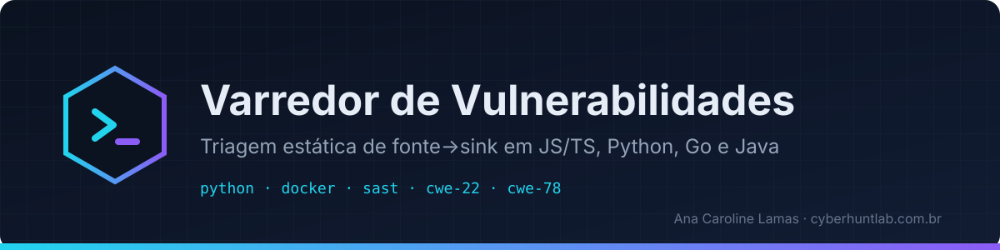

<p align="center"></p>

# Varredor Inteligente de Vulnerabilidades — triagem estática multilinguagem

Scanner de **triagem estática** em **Python** que aponta onde **entrada não confiável** (`req`, `query`, `argv`) chega a uma **função perigosa**. Cobre path traversal, injeção de comando, segredo em log e credencial hardcoded em **JavaScript/TypeScript, Python, Go e Java**. Pode ser usado direto ou em **Docker**.

> É uma ferramenta de **triagem**: destaca pontos suspeitos para revisão e não prova exploração. Confirme cada achado manualmente antes de qualquer report.

## Recursos

| CWE | Risco | Como detecta |
|---|---|---|
| CWE-22 | Path traversal | Entrada chegando a `readFile`, `sendFile` ou `open` |
| CWE-78 | Injeção de comando | Entrada chegando a `exec`, `spawn`, `system` ou `subprocess` |
| CWE-522 | Segredo exposto em log | `secret`, `token` ou `senha` dentro de `console.log`/`print` |
| CWE-798 | Credencial hardcoded | `senha`, `api_key` ou `token = "…"` (português e inglês) |

- **Filtro de falsos positivos**: ignora comentários, textos de ajuda (`--help`, `usage`, `example:`) e caminhos estáticos seguros (`path.join(__dirname, …)`, `process.cwd()`).
- **Autoteste** embutido, executado também durante o `docker build`.
- Sem dependências externas.

## Instalação

### Docker

```bash
git clone https://github.com/ticarollamas-arch/varredor-vulnerabilidades.git
cd varredor-vulnerabilidades
docker build -t varredor .     # o build falha se o autoteste falhar
```

### Python

Requisitos: **Python 3.10+** (a imagem usa 3.12).

## Como usar

```bash
docker run --rm -v /caminho/do/projeto:/code varredor   # analisa um projeto montado em /code
docker run --rm -v "$PWD":/code varredor                # pasta atual (inclusive no Termux)

python3 scanner.py /caminho/do/projeto                  # sem Docker
python3 scanner.py --test                               # autoteste
```

## Limitações

- O casamento é por linha: fonte e *sink* precisam estar na mesma linha (não segue variáveis entre linhas).
- Usa expressões regulares, não AST: código ofuscado ou muito dinâmico pode escapar.
- Reduz o que chega à revisão manual, mas não a substitui.

## Tecnologias

Python 3 · expressões regulares · Docker · CWE (MITRE)

## Licença

Distribuído sob a licença MIT. Veja [LICENSE](LICENSE).
